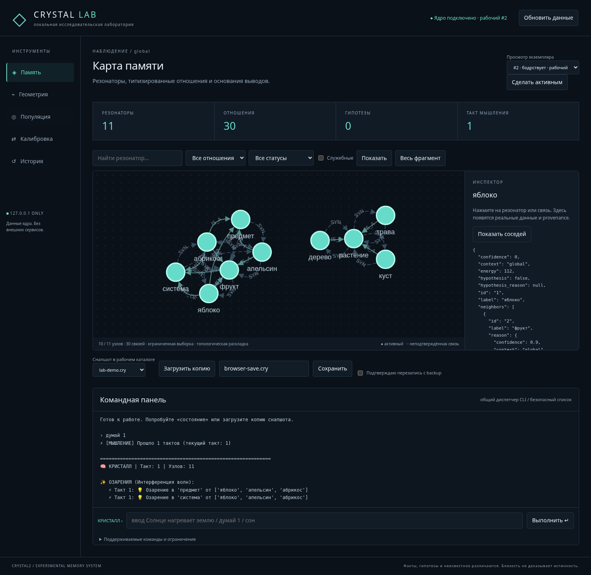
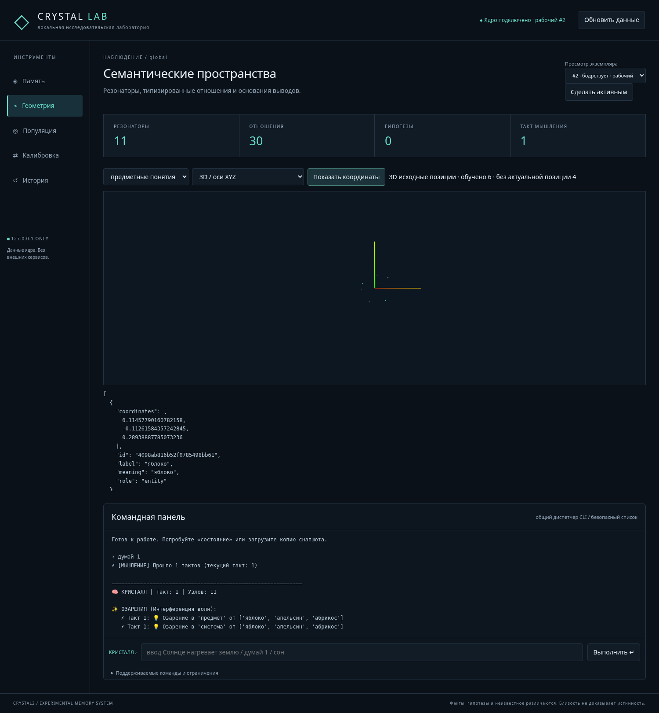

# Crystal Lab — локальная исследовательская веб-лаборатория

Исходный HEAD: `89b2084` (main после PR #5). Flask + обычные HTML/CSS/JS,
локальные Cytoscape.js 3.30.4 и Three.js 0.160.1. Без React, Node build,
внешнего ИИ и сетевых запросов при работе приложения.



Скриншот получен браузерным тестом на **синтетическом демонстрационном снапшоте**,
созданном настоящими CrystalLattice/SemanticSpace. Это не предзаполненные данные
интерфейса: без загрузки памяти приложение показывает только исходный SELF.

## Windows 10/11, Python 3.12+

В PowerShell из checkout:

```powershell
py -3.12 -m venv .venv
.\.venv\Scripts\python.exe -m pip install -r requirements.txt
$labWorkspace = Join-Path $env:USERPROFILE "CrystalLabData"
New-Item -ItemType Directory -Force $labWorkspace
.\.venv\Scripts\python.exe -X utf8 -m crystal_lab --workspace $labWorkspace
```

Откройте в браузере `http://127.0.0.1:5050`. Сервер не имеет параметра для внешнего
bind, debug/debugger/reloader выключены. Для другого локального порта: `--port 5052`.
Второй поддерживаемый launcher с тем же workspace блокируется OS lease
(flock на Linux, msvcrt на Windows). Для независимого опыта используйте другой
рабочий каталог. Не запускайте несколько WSGI workers или другие процессы,
изменяющие эти же файлы; поддержан один локальный процесс.

Для своих данных поместите **копию** `.cry` в этот каталог средствами ОС. Сервер
не читает произвольные пути, переданные браузером. Выберите файл в панели снапшотов
и нажмите «Загрузить копию». В `backups/` создается еще одна копия импорта, из нее
загружается новый экземпляр популяции. Предыдущий экземпляр остается в памяти,
исходный файл не перезаписывается. Допустимы только plain `.cry` имена;
symlinks, выход из workspace, Windows device names и абсолютные пути блокируются.
Служебные файлы приложения и vendored assets читаются из checkout; пользовательские
данные и записи находятся только в выбранном workspace.

Для контролируемого первого опыта до запуска или после остановки сервера:

```powershell
.\.venv\Scripts\python.exe -X utf8 examples\lab_demo.py $labWorkspace
```

Он создает `lab-demo.cry` и `lab-examples.json` и отказывается их перезаписывать.
Загрузите demo в интерфейсе, затем на вкладке «Калибровка» вставьте содержимое
`lab-examples.json`. В источниках явно указано Synthetic Lab demonstration;
это тестовые допущения, а не факты, самостоятельно открытые системой.

Linux/macOS: `python3 -m venv .venv`, `.venv/bin/python -m pip install -r requirements.txt`,
`.venv/bin/python -m crystal_lab --workspace /path/to/lab-data`.

### Работа без интернета

Flask и его зависимости устанавливаются один раз. JS, лицензии и версии включены
в `crystal_lab/static/vendor`; CDN и шрифтов извне нет. Tarballs проверены по
SHA-512 integrity npm; источники и integrity находятся в `manifest.json`.
Для полностью офлайн-установки заранее на машине той же ОС/архитектуры/Python
скачайте wheels: `python -m pip download -r requirements.txt -d wheelhouse`,
перенесите checkout и wheelhouse, затем
`python -m pip install --no-index --find-links wheelhouse -r requirements.txt`.
Node.js нужен ни для установки, ни для запуска лаборатории.

## Что показывает интерфейс

**Память.** Число узлов, направленных типизированных записей (обратный SYN считается
отдельно), гипотез, такт, контекст и состояние. Cytoscape показывает ограниченный
фрагмент, а не весь граф. По умолчанию 150 узлов, максимум API 300 и 1200 ребер.
Выборка приоритетна по энергии; поиск по подстроке, служебные узлы, тип отношения,
статусы и one-hop окружение доступны отдельно. Раскладка Cytoscape — топология,
не обученные координаты SemanticSpace. Zoom/pan и выбор узла/ребра открывают реальные
статусы, соседей, основания, source и context. Сплошное ребро означает confirmed
provenance, пунктир — отсутствие подтверждения; статус узла показывается отдельно.
Legacy-файлы без provenance остаются неопределенными, ничего не додумывается.
Provenance-summary ограничивает metadata 4096 символами и показывает признак
усечения; родительские основания представлены до 20 кратких ссылок.

**Геометрия.** Только существующий SemanticSpace: миры, значения, роли и полные
координаты в таблице. Необученные/устаревшие позиции — null и не рисуются.
2D отображается непосредственно, 3D — Three.js с вращением перетаскиванием и zoom
колесом. В 8D используется явно подписанная проекция первых трех осей, не PCA и
не исходный 3D. Плоскость XY для многомерных данных также подписана проекцией.
Переключатель вида не переобучает модель и не выдумывает недостающие измерения.
До 500 значений на запрос; нет загрузки 100000 точек. WebGL может отсутствовать:
в таком случае остаются реальные координаты и доступная 2D-проекция.



**Популяция.** Active_index и is_dormant из настоящей CrystalPopulation.
Список «Просмотр экземпляра» не меняет рабочую lattice. Кнопка активации меняет
ее явно; команды/обучение относятся к рабочему экземпляру. Сайт проверяет активный
индекс перед изменением, чтобы старое окно не применило команду к новой памяти.
События переноса публикуются из самого recall_from_hive_mind после реального
копирования (source/target/anchor/counts). Это перенос, а не объявленная эволюция.
Другие внутренние механизмы популяции работают только когда их вызывает общий CLI.

**Обучение.** Импорт JSON TrainingExample[], выбор только train, редактирование
references без изменения semantic gold, просмотр relations. Существующий learner
выполняет максимум 8 кандидатов / 200 suite evaluations с guard_previous=True.
Validation обязателен; test не служит примером для обучения. Доступны before/after,
диагноз, provenance, измененные параметры, кандидаты и компонентные метрики,
причины допуска/отказа, история и rollback. Простой текст не подтверждает знания.
Параметры и история входят в существующие снимки; набор импортированных примеров
относится к сессии Lab и после перезапуска импортируется снова. Новая геометрия и
полный геном через сайт не обучаются.

**История.** До 100 операций в текущем процессе. Реальные новые/удаленные узлы,
типы отношений, число измененных весов, энергия, belief/TruthValue, гипотезы,
параметры и события переноса. Подробности diff ограничены 100 элементами, totals
не обрезаются. Переключение экземпляров помечено отдельно: оно не выдается за
мутацию другой lattice. Синтетической анимации изменений нет. История Lab в целом
не восстанавливается из одиночного `.cry`; imitation history восстанавливается.

## Команды и общий диспетчер

CLI и сайт используют один `CommandSession.execute`. Исходные command branches
из main.py выделены в command_session.py; терминальный запуск сохраняет banner,
инициализацию и интерактивные prompts. `capture=False` у терминала не прячет
вложенный input; веб получает захваченный output/error. EOF терминала завершает REPL.
Веб не интерпретирует ввод как Python или shell, eval/exec/subprocess для команд нет.

Разрешены:

```text
ввод <текст>            ложь <текст>             отрицание <А> <Б>
думай [1..10]           сон                      отжиг
состояние               спроси <вопрос>          ответь
объясни                 аналогии <узел>          связи <узел>
сравни <А> от <Б>        гипотезы                 подтверди <узел>
опровергни <узел>        контексты                качество <цель>
популяция               фреймы
```

`подтверди` — явное действие исследователя по существующему CLI, не автоматическое
доказательство. `спроси` и некоторые диагностические команды ядра могут менять
runtime; поэтому вызываются через POST и фиксируются в истории. HTTP GET наблюдения
не вызывает их. Сетевые `изучи`, чтение книг, свободные пути, запись профилей,
вложенные prompts и другие CLI-команды не доступны из браузера. Снапшоты управляются
отдельной безопасной панелью. Полный терминальный CLI остается доступен локально.

## REST API

GET не меняет память. Для `instance=N` можно просматривать конкретный экземпляр.
POST JSON требует `X-Lab-Token` из локальной страницы. Origin и Host ограничены,
CORS отсутствует; CSP допускает только собственные скрипты. `_instance` позволяет
отклонить устаревший mutating запрос. API по умолчанию изменяет active_index.

| Метод | Путь | Назначение |
|---|---|---|
| GET | `/api/status` | состояние и список команд |
| GET | `/api/instances` | популяция |
| POST | `/api/instances/select` `{id}` | рабочий экземпляр |
| GET | `/api/graph` | limit, q, type, services, scope, node |
| GET | `/api/nodes/<id>` | узел, основания, до 300 соседей |
| GET | `/api/relations/<source>/<target>/<type>` | отношение и причина |
| GET | `/api/geometry?world=...` | настоящие позиции и unknown |
| POST | `/api/commands` `{command}` | общий CLI dispatcher |
| GET | `/api/history` | diff и события |
| GET | `/api/snapshots` | .cry файлы в workspace |
| POST | `/api/snapshots/load` `{name}` | загрузить копию в новый экземпляр |
| POST | `/api/snapshots/save` `{name, confirm_overwrite}` | atomic replace после backup |
| GET | `/api/training` | примеры и imitation_state |
| POST | `/api/training/examples` `{examples}` | импорт без создания фактов |
| POST | `/api/training/run` `{id, reference?}` | ограниченная калибровка |
| POST | `/api/training/rollback` `{}` | прежние параметры |

## Сохранность и бюджеты

Одна операция над памятью за раз, read-lock дает согласованный снимок. Конфликтующий
POST получает 409. Перед операцией сохраняется backup выбранной lattice, а session
копируется в памяти. При исключении восстанавливаются популяция/кэши, global RNG и
файл learned rules. Ошибка импорта не заменяет текущую память. Before/after берется
не из визуального состояния, а из действительных объектов ядра. Это не обещание
транзакционности произвольно поврежденного legacy reader вне обертки Lab.

Рабочие .cry не перезаписываются без checkbox `confirm_overwrite=true`. Перед replace
сохраняется также копия существующего файла, запись идет через временный файл.
Core snapshot сохраняет один экземпляр, а не всю популяцию и не все transient
структуры. Источник загруженной копии остается неизменным.

Лимиты: HTTP body 128 KiB, команда/новый reference 2000 символов, tick до 10,
обычная мутация до 10000 узлов и 40000 typed edges. Сон/отжиг/сравнение/качество/
запрос ограничены 500 узлами и 4000 отношениями. Большую память можно просматривать,
сохранять и переключать, но не запускать дорогие команды через Lab. Файл импорта
до 32 MiB, популяция до 8 экземпляров, импорт до 100 TrainingExample,
история калибровки до 100 попыток. Превышение бюджета отклоняется, не маскируется.

Backup-хранилище: до 200 файлов либо 512 MiB уже сохраненных файлов, затем новые
изменения блокируются. Backup автоматически не удаляется: остановите сервер,
архивируйте копии и освободите каталог. Каталог принадлежит локальному исследователю;
не передавайте право его изменения недоверенным процессам во время работы.

## Проверки и ограничения

```powershell
.\.venv\Scripts\python.exe -X utf8 -m unittest discover -s tests -v
# Необязательные реальные browser tests:
.\.venv\Scripts\python.exe -m pip install playwright
.\.venv\Scripts\python.exe -m playwright install chromium
.\.venv\Scripts\python.exe tests\lab_browser.py
```

На Linux выполнены 62 unit/API-теста и отдельный сценарий в настоящем Chromium:
загрузка копии → поиск/инспектор → такт/diff → импорт train/validation → две
калибровки → rollback → 3D → сохранение → просмотр популяции без активации.
В browser test запрещены все внешние запросы; ошибок pageerror и сетевых
обращений за пределы localhost не было. Скриншоты выше получены этим сценарием.
Для system Chromium задается `CRYSTAL_LAB_BROWSER`; для сохранения скриншотов —
`CRYSTAL_LAB_SCREENSHOTS`. Эти зависимости нужны только тестам, не самому сайту.

Windows-ветка lease и запуск спроектированы для Python 3.12 и стандартных путей,
но реальная Windows-машина в этой сессии не запускалась. Проверки выполнены на Linux.
Произвольные сильно поврежденные snapshots, многочасовые опыты, графы 100000 узлов,
полный перезапуск многокристальной популяции и все старые CLI-команды не заявляются
проверенными. Нет remote access, realtime multiuser режима и фонового task scheduler.
Это локальный инструмент исследователя с явными лимитами, не production-сервис.
