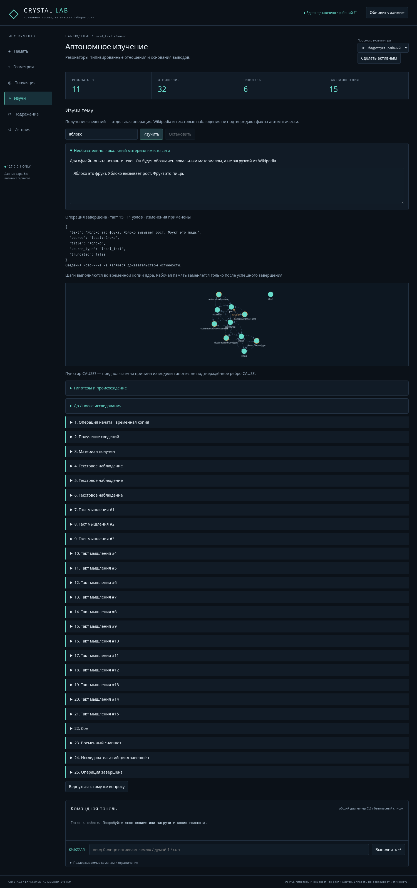
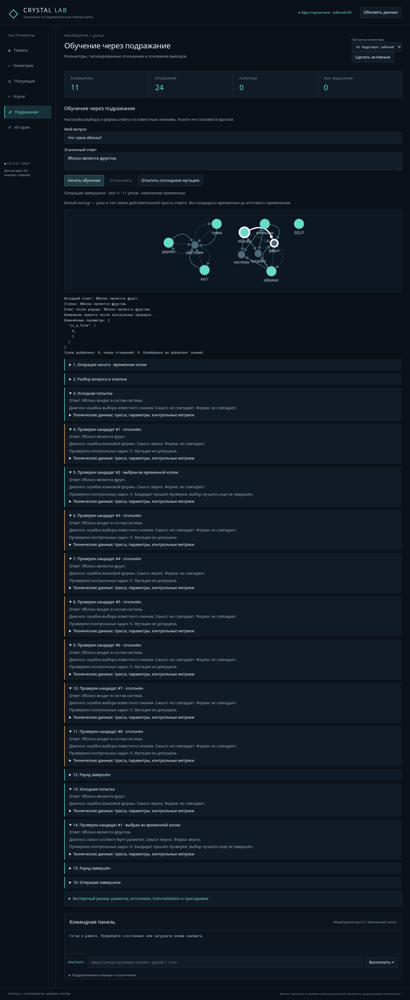

# Crystal Lab: «Изучи» и интерактивное подражание

Аудит исходного main `93a2ba2`: `main.autonomous_research` уже выполнял
Wikipedia → membrane → 15 ticks → defragment/anneal → snapshot, но чтение ответа
было неограниченным, промежуточные шаги не выдавались, а сеть/ядро выполнялись
в одном синхронном CLI-вызове. ImitationLearner уже проверял ограниченные кандидаты,
но не предоставлял callbacks; веб требовал JSON и показывал итог целиком.

Теперь общий цикл находится в `research.research_steps`, и его используют
терминальный `autonomous_research` и вкладка «Изучи». Прежние сигнатуры CLI и
`wiki_probe` сохранены. В существующий ImitationLearner добавлены необязательные
`on_event`/`should_stop`, без второго оптимизатора и без изменения допустимых мутаций.

## Запуск на Windows 10/11, Python 3.12+

Из checkout в PowerShell:

```powershell
py -3.12 -m venv .venv
.\.venv\Scripts\python.exe -m pip install -r requirements.txt
$labWorkspace = Join-Path $env:USERPROFILE "CrystalLabData"
New-Item -ItemType Directory -Force $labWorkspace
.\.venv\Scripts\python.exe -X utf8 -m crystal_lab --workspace $labWorkspace
```

Браузер: `http://127.0.0.1:5050`. JS-библиотеки локальные. Нет debug, reloader,
remote bind, команд ОС или Python eval. Прежние host/origin/token/path/lease
проверки сохранены. Flask теперь принимает несколько HTTP-соединений для SSE,
но разрешена лишь одна операция изменения памяти. Это не multiuser-сервис.
Windows-запуск здесь не исполнялся; фактические проверки выполнены на Linux.

## Сценарий A: исследование «яблоко»

1. Откройте «Изучи», введите `яблоко`, нажмите «Изучить».
2. При наличии сети будет запрос только к `https://ru.wikipedia.org/w/api.php`.
   Показаны точный источник, материал, признак усечения и статус внешних сведений.
3. По завершении каждого настоящего шага приходят события: предложения-наблюдения,
   такты с энергиями резонаторов, сон/отжиг, гипотезы и их происхождение, snapshot,
   итоговый diff. До/после содержит реальные counts и изменения, не анимацию обучения.
4. Успешная работа публикует новый `study-<job id>.cry` в workspace и заменяет
   рабочую копию памяти. Старые снимки не перезаписываются, backup сохраняется.

**Сеть этого cloud-сеанса:** реальная попытка загрузить Wikipedia для «Яблоко»
получила `URLError: Tunnel connection failed: 403 Forbidden` от egress proxy.
`ru.wikipedia.org` добавлен в черновик сетевых настроек с сохранением прежнего
`api.github.com`. Черновик не применяет runtime policy и не публикует среду:
нужно сохранить/опубликовать настройки окружения, затем проверить запрос заново.
Успешная настоящая загрузка Wikipedia в этом сеансе **не подтверждена**.
При локальном запуске Windows доступ зависит от вашей сети и TLS/proxy-настроек.

Для работающего **офлайн-опыта** раскройте «Локальный материал вместо сети» и вставьте:

```text
Яблоко это фрукт. Яблоко вызывает рост. Фрукт это пища.
```

Это явно синтетические текстовые наблюдения для испытания движка, не ботаническое
доказательство. Источник отображается как `local:яблоко`, source_type=local_text,
не как Wikipedia. На пустой lattice выполнено 15 настоящих ticks и сон; создано
10 новых узлов и 32 типизированные записи, одна предполагаемая причинная связь,
0 автоматически подтвержденных отношений. Число узлов/связей не объявляется
доказательством приобретения истинных знаний. Абстракций сна в этом маленьком
примере может не быть: интерфейс показывает ноль, а не выдумывает их.



Полный фактический поток: [study-scenario.json](docs/study-scenario.json).
Фикстура получена browser-тестом с локальным текстом. Отдельный unit-тест проверяет
контракт Wikipedia-ответа на подставленном ответе; он не считается онлайн-проверкой.

### Разделение эпистемических статусов

- Загруженный материал — внешние сведения с URL/источником.
- Предложения — текстовые наблюдения в relation_observations и эпохе источника.
- Извлеченные IS_A/SYN и другие отношения — данные parser/membrane, не независимое
  подтверждение. Новые ребра получают observed provenance и source_document.
- Причинные кандидаты остаются в causal_hypotheses; оранжевый пунктир CAUSE? —
  отображение этого объекта модели, а не подтвержденный EDGE_CAUSE.
- Гипотезы сна содержат исходный reason, context и реальные компоненты, если есть.
- Ранее подтвержденное происхождение и вес отношения не стираются более слабым
  текстовым наблюдением. Новое наблюдение сохраняется отдельно.

Верхний счетчик показывает узловые и предполагаемые причинные гипотезы; прежний
API field `hypotheses` сохранен для совместимости, добавлены отдельные counts.
В инспекторе узла доступны относящиеся к нему causal hypotheses. Никакого нового
механизма установления истины в этой работе не добавлено. Bitwise TruthValue
существующего ядра не равен независимой проверке текстового утверждения.

## Сценарий B: два поля для подражания

Для повторяемого опыта подготовьте подтвержденную тестовую память:

```powershell
.\.venv\Scripts\python.exe -X utf8 examples\lab_demo.py $labWorkspace
```

Скрипт отказывается перезаписывать существующие demo-файлы. Загрузите копию
`lab-demo.cry` в Lab. Вкладка «Обучение через подражание»:

- Мой вопрос: `Что такое яблоко?`
- Эталонный ответ: `Яблоко является фруктом.`
- Нажмите «Начать обучение». JSON/ID/splits для этого не нужны.

На тестовой памяти исходный ответ выбирает сильное PART_OF вместо IS_A.
Первый раунд принимает request_weight: 0 → 0.25, второй выбирает is_a_form: 0 → 1.
Интерфейс показывает исходный текст, эталон, настоящий ответ каждого кандидата,
диагноз, компоненты качества, результат контролей и выбор во временной копии.
Лишь итоговое сообщение «изменения применены» означает публикацию параметров.
Белые контуры отмечают реальные path IDs и выбранный тип отношения. Узлы,
HDC, связи и координаты при калибровке не меняются.



Полный поток: [imitation-scenario.json](docs/imitation-scenario.json).
Это положительный контролируемый пример выбора заранее реализованных механизмов,
не универсальное понимание русского языка и не доказательство метаобучения.

Попробуйте эталон `Яблоко растёт на яблоне.`: эта конструкция не поддерживается
надежным формальным разбором. UI сообщает ограничение, показывает исходную попытку
и не применяет мутации. Нет постановочной успешной финальной фразы.

### Простой адаптер и независимые контроли

`simple_imitation.py` только подготавливает TrainingExample и контроли для
**существующего** ImitationLearner. Поддержаны вопросы `Что такое X?`, `Чем является X?`,
`Частью чего является X?`, `Что вызывает X?`, метка X и явные запросы IS_A/PART_OF/CAUSE.
Эталоны: ограниченные конструкции «X является Y», «X это Y», «X входит в состав Y»,
«X вызывает Y», «X приводит к Y», с ограниченным регулярным instrumental.

Сопоставление идет с точными известными метками/формами membrane. Если значение
или форма неоднозначны, если вопрос и эталон расходятся по субъекту/типу, gold
не придумывается. Неизвестная конструкция не сопоставляется по сходству строк.
Разметка преподавателя трактуется как намерение ответа, а не универсальный факт.
Проверка наличия подтвержденного ребра остается обязательной.

Validation автоматически строится из других субъектов с уже подтвержденными
отношениями и достаточно надежным provenance. Для одного типа/запроса допускаются
все известные корректные отношения, а не произвольное одно. Train-субъект исключен,
зарегистрированные test-запросы исключены без чтения их references/relations.
Test-ответы не поступают в learner или генерацию мутаций. Если независимых контролей
не хватает, изменение не принимается; дубликат train не выдается за validation.

Эти контроли проверяют согласованность с существующей памятью, а не являются
независимым эмпирическим установлением истины. Формы контролей строятся фиксированной
ограниченной грамматикой, а не копированием пользовательского эталона. Мир/контекст
и неоднозначные semantic bindings учитываются; геометрическая близость не заменяет
подтвержденное знание. Защита старых навыков learner остается включена.

Экспертный режим находится в свернутом блоке: прежний JSON import, источники,
train/validation/test, formal relations, параметры, before/after и трассировки
по-прежнему доступны. Он не нужен для простого сценария.

## Недостаток знаний и связь с «Изучи»

При отсутствии необходимого подтвержденного отношения выдаётся D; при ненадежном
разборе — неопределенность с альтернативами. Предлагаются два отдельные действия:

1. «Изучить тему» открывает вкладку исследования; вопрос/эталон сохраняются.
   После завершения кнопка возврата позволяет повторить тот же опыт.
2. «Добавить как обучающее свидетельство» — отдельный POST с backup. Текст проходит
   membrane и записывается как user_correction/observed. Это не обучение параметров
   и не подтверждение факта. Новый текст не получает status=confirmed автоматически.

Изучение Wikipedia также не гарантирует, что следующая калибровка станет допустима:
наблюдения и гипотезы могут требовать внешнего подтверждения. Интерфейс этого не скрывает.

## Поток, остановка и транзакции

POST запускает один worker на deepcopy текущей CommandSession/CrystalPopulation.
На копии изолированы lattice, membrane caches, learner history и файлы learned rules.
GET-эндпоинты наблюдают согласованное исходное ядро; отдельные графы job показывают
**временный настоящий движок**, что явно подписано. Другие POST-модификации отклоняются
на все время работы job, включая импорт, select, экспертное обучение и rollback.

SSE `text/event-stream` публикует завершенные шаги немедленно. Нет фиктивных задержек
и анимации «успеха». Быстрая операция может завершиться до подключения браузера —
в этом случае воспроизводится сохраненный поток. Sequence/Last-Event-ID обеспечивают
повторное подключение без дублей. Временные кандидаты, прошедшие контроли, еще не
считаются выбранными; раунд явно указывает победителя. Подробности раскрываются
по желанию, основной режим показывает понятные ответы и диагнозы.

Остановка проверяется до каждого предложения/tick/candidate и после текущего шага.
Текущий сетевой read или вызов сна не убивается посередине. После остановки новые
итерации не начинаются; вся временная работа, включая уже выбранные параметры
предыдущего раунда, отбрасывается. Основное ядро и исходные rules остаются прежними.
Если атомарная публикация уже завершилась, stop возвращает completed, а не обещает
откат состоявшегося изменения. «Откатить последнюю мутацию» использует прежний
learner.rollback; после двух успешных раундов для полного возврата нужны два отката.

Перед стартом создается прежний backup .cry. Успех исследования сначала завершает
временные файлы, проверяет объем/сериализацию финального события, затем публикует
rules и новый уникальный snapshot и меняет память под lock. Ошибка публикации
возвращает прежние rules, не заменяя session. Проверен искусственный сбой rename.
Если калибровка отказалась от всех кандидатов, даже исходный imitation_state/cache
не заменяется пустой default-версией: сохраняются только отчет job и история Lab.
После отмены/сбоя global RNG восстанавливается. Прерывание процесса ОС не является
поддерживаемым атомарным checkpoint всей популяции; backup остается на диске.

Отчеты и временные артефакты: `workspace/jobs/<UUID>/events.json` и при необходимости
старая копия rules. Их не нужно открывать для обычного использования. Отчеты последних
пяти jobs доступны в API процесса; после перезапуска автоматического возобновления
job нет. Полный reload страницы не восстанавливает несохраненные поля формы.

### Бюджеты

- Тема до 200 символов; вопрос и эталон до 2000.
- Wiki: только HTTPS ru.wikipedia.org:443, не более двух разрешенных redirects,
  TLS/proxy сохраняются. Ответ до 256 KiB, материал до 12000 символов.
- Timeout одного сетевого ожидания 8 с; общий download budget 12 с проверяется
  между read1-порциями. Остановка может ждать текущего read до его timeout.
- До 50 предложений, 15 ticks, 500 узлов и 4000 typed relations; сон сохраняет
  имеющуюся логику ядра. Превышение отклоняет весь временный результат.
- Подражание: максимум два раунда, восемь кандидатов и 200 suite evaluations на раунд,
  guard_previous включен, координаты/геном/подтвержденные знания не мутируют.
- До 160 событий на job, 256 KiB на событие; job-граф до 80 узлов/250 записей,
  списки гипотез до 50. Неполнота выборки не означает отсутствие остальных знаний.
- Пять отчетов jobs в памяти, до 50 job-каталогов на диске; затем архивируйте их
  при остановленном сервере. Старые backup-лимиты Lab также сохранены.

## Дополнительный REST API

| Метод | Путь | Действие |
|---|---|---|
| POST | `/api/study/start` | `{topic, ticks?:0..15, material?:local_text, _instance?}` |
| POST | `/api/imitation/start` | `{question, reference, _instance?}` |
| GET | `/api/jobs/<id>` | состояние и события bounded job |
| GET | `/api/jobs/<id>/events` | SSE, поддержан Last-Event-ID |
| POST | `/api/jobs/<id>/stop` | запрос безопасной остановки |
| POST | `/api/imitation/observation` | отдельное неподтвержденное свидетельство |

Все POST требуют прежний X-Lab-Token и локальный Origin/Host. URL источника
не задается браузером. В тестах fetcher подставляется только через server config.
Прямая команда «изучи» в общем синхронном command API по-прежнему запрещена:
ее функция предоставлена управляемой вкладкой с остановкой и ограничениями.

## Проверки и честные ограничения

```powershell
.\.venv\Scripts\python.exe -X utf8 -m unittest discover -s tests -v
# Необязательно, для браузерных сценариев:
.\.venv\Scripts\python.exe -m pip install playwright
.\.venv\Scripts\python.exe -m playwright install chromium
.\.venv\Scripts\python.exe tests\lab_browser.py
.\.venv\Scripts\python.exe tests\lab_interactive_browser.py
```

Выполнены 75 unit/API-тестов: 62 прежних и 13 новых. Включены реальная обработка
материала/такты/сон, неприсвоение confirmed, сохранение прежнего provenance,
stream до окончания worker, cancel, busy rejection, отказ по сети, byte-equal
сохранность session при отказе, восстановление rules при ошибке публикации,
SSE replay, размер ответа, запрет утечки test-ответов и отсутствие самовалидации.
Оба real Chromium сценария A/B и прежний browser regression прошли без pageerror
и внешних браузерных запросов. Сеть Wikipedia была проверена отдельно и заблокирована
прокси — успешный online-сценарий не подменяется локальной фикстурой.

Не реализованы универсальная семантика русского языка, автоматическое доказательство
истинности Wikipedia, произвольная новая грамматика, принудительное прерывание Python
внутри одного tick/sleep, распределенные workers или восстановление job после crash.
Существующий learner выбирает из ограниченного набора параметров/форм. Положительный
контролируемый пример не доказывает интеллектуального прогресса по числу узлов или
по текстовому совпадению. На неподдерживаемом эталоне честный отказ является результатом.
