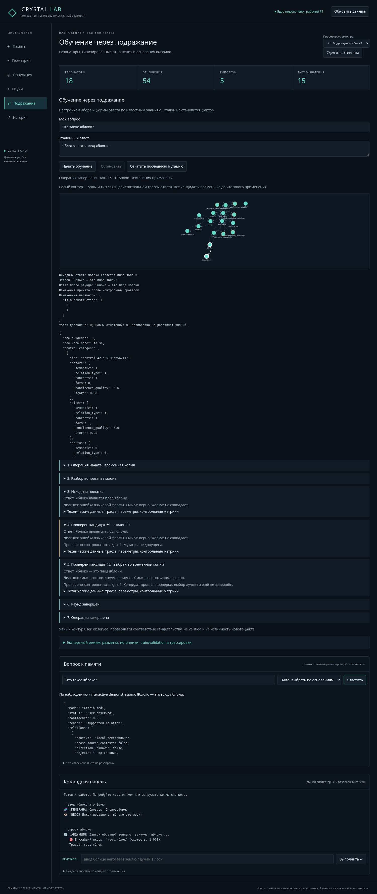

# Crystal2: наблюдение → ответ → условная калибровка

## Аудит и причина тупика

База сравнения — актуальный `origin/main` на момент начала, `929f721`.
Изменения выполнены в `fix/observation-answer-learning`.

Прослежена цепочка `research_steps → ingest_observation → LanguageMembrane →
CrystalLattice → generate_text → ImitationLearner`. Старый парсер узнавал некоторые
копулы, но выбирал последние отдельные слова предложения вместо полной именной
группы. `является` и определение через тире не давали надежной структуры.
`generate_text` правильно требовал confirmed, однако не предлагал отдельного
ответа по наблюдению. Простой адаптер имитации также требовал confirmed; добавление
неподтвержденного текста не могло снять блокировку. Наконец, `defragment` мог
удалить нулевую по энергии цель IS_A без исходящих ребер, хотя на нее ссылался
другой узел. Регрессия отдельно проверяет сохранность таких целей.

## Что изменилось

`structured_observations.py` — небольшая общая грамматика наблюдений и эталонов.
Она обрабатывает `X это Y`, `X — Y`, `X является Y`, `X является частью Y`.
Полная группа `плод яблони` или `цитрусовый плод` остается одной целью IS_A.
Родительный квалификатор не объявляется отдельным отношением происхождения.
Регулярное окончание головы `-ом` допускает кандидата нормализации; это явно
отмечено в записи. Для неизвестного склонения сохраняется исходная форма и
исходное предложение, а не выдумывается универсальная лемматизация.

Каждое предложение сохраняет результат разбора, source_document, контекст,
статус и причину отказа. Неоднозначные/отрицательные/модальные определения
не становятся положительным IS_A. Известные неподдерживаемые конструкции
свойства, происхождения и принадлежности дают PROPERTY / ORIGIN / OWNERSHIP
с диагностикой. Они не подменяются доступным типом ребра. Остальные лексические
SYN и существующие причинные гипотезы продолжают формироваться своим механизмом.
Все новые определения — observed; пользовательская демонстрация — user_observed.

Стабильные алиасы соединяют текстовый запрос со структурным узлом без нечеткого
назначения ему чужого факта. Сон сохраняет явно привязанные структурные узлы и
входящие цели. Обратные волны, HDC-идентичности, геометрия, геном и алгоритм
распространения энергии не заменяются новым поисковиком.

### Политика ответа

| Режим | Основание | Выход |
|---|---|---|
| Verified | Типизированное отношение, status=confirmed, не hypothesis, подходящий контекст | Утверждение с provenance |
| Attributed | Типизированное observed/user_observed с источником | «По наблюдению …», статус и confidence ≤ 0.6 |
| Hypothesis | Реальный объект гипотезы / hypothesis provenance | Явное «Предположение», confidence ≤ 0.4; неизвестное направление CAUSE не утверждается |
| Associative | Старый экспериментальный генератор | Явная метка ассоциативного эксперимента |
| Unknown | Нет подходящего основания / конфликт / неоднозначность | Причина отказа без вымышленного отношения |

Auto выбирает Verified → Attributed → Hypothesis. Он не подтверждает наблюдение.
Последовательные статьи имеют контексты `source_observation` с родителем —
исходным смысловым контекстом. Attributed может процитировать другой источник
в той же области; `source_context` и `cross_source_context` видны в отношении.
Контекст статьи не объявляется новым смысловым миром. Источник из отдельного
диалогового/смыслового контекста не переносится за его пределы. Verified не
использует этот допуск. Legacy-контексты автоматически не переклассифицируются.

SYN не служит основанием фактической конструкции. Числа confidence здесь —
ограниченные эвристические оценки, не измеренные вероятности истинности.
Конфликт в применимом основании приводит к Unknown. Неизвестное понятие,
отсутствующее отношение, неподтвержденное наблюдение, неоднозначное значение и
неподдерживаемый разбор различаются кодами причин.

Совместимый `generate_text(..., mode='factual')` остается строгим Verified.
Явные режимы доступны через `membrane.respond(query, mode)` и `generate_text`.
CLI `спроси …` / `ответь` теперь явно использует auto; обратная волна по-прежнему
выполняется, но сама активация не подтверждает текст. В Lab отдельная панель
вопроса показывает режим, отношения, источники, статус и причину отказа.

### Имитация без confirmed

Два поля сохраняются. Первая попытка не меняет память. Структура эталона и
недостающее отношение показываются пользователю. Отдельная кнопка добавляет
**структурированное свидетельство user_observed**, а не достоверный факт и не
успешную мутацию. Проверка применимости к вопросу выполняется заново. При
неподдерживаемом разборе добавление отклоняется с точной причиной.

Для калибровки по такому свидетельству требуется явный режим
`TrainingExample.evidence_mode='user_observed'` и
`Config.allow_user_observed=True`; обычный API и экспертный verified-режим
сохраняют прежние ограничения. Сам текст из Wikipedia такого допуска не дает.
Нужны контрольные примеры по другим субъектам: confirmed либо явно добавленные
user_observed в этом условном режиме. Без них мутации не принимаются.
Источник и scope контролей видны в анализе. Несколько допустимых целей одного
субъекта/типа группируются как альтернативы. Test-ответы не читаются; test-запросы
исключаются из автоматически выбранного validation.

Используется прежний ImitationLearner, временная копия, бюджет, проверки прошлых
навыков и rollback. Добавлен один общий переключатель речевой конструкции
`is_a_construction`: «является …» / «— это …». Он не хранит пары вопрос–ответ.
Принятые параметры работают в генераторе imitation/`answer`; обычная политика
Attributed остается отдельной от подстройки формы. Изменения формы не объявляются
новым знанием или улучшением рассуждения. Confidence свидетельства остается ≤ 0.6.

UI отдельно показывает новые свидетельства, изменение параметров/текста,
принятие мутации и компонентные изменения на контролях. SSE содержит настоящие
initial/candidate/round события. Остановка и сбой не публикуют временную модель.

## Воспроизведение до/после

Изолированное сравнение выполнено одним скриптом на исходных модулях `929f721`
и на новой ветке. Seed=17; study использует явную офлайн-фикстуру контракта
Wikipedia, три предложения из запроса. Это не успешная загрузка живой Wikipedia.
Старое состояние не редактируется; оба legacy-файла загружаются в новые lattice.

Обозначения таблиц: O — записи наблюдений, T — направленные типизированные ребра
всех типов (включая SYN), H — гипотезы узлов + causal, C — confirmed отношения,
A — допустимый ответ на запрос «яблоко» (0 или 1, не число всех возможных фраз).
Увеличение T/H/O не является метрикой интеллекта. O включает исходные записи
предложений, структурные результаты и общую запись источника; поэтому это не
количество независимых подтверждений.

### Чистое состояние

| Шаг | До O/T/H/C/A | После O/T/H/C/A | Режим до → после |
|---|---|---|---|
| initial | 0/0/0/0/0 | 0/0/0/0/0 | Unknown → Unknown |
| ввод яблоко это фрукт | 0/3/0/0/0 | 1/3/0/0/1 | Unknown → Attributed |
| спроси яблоко | 0/3/0/0/0 | 1/3/0/0/1 | Unknown → Attributed |
| ответь | 0/3/0/0/0 | 1/3/0/0/1 | Unknown → Attributed |
| изучи яблоко (offline fixture) | 3/38/4/0/0 | 7/46/5/0/1 | Unknown → Attributed |
| спроси яблоко after study | 3/38/4/0/0 | 7/46/5/0/1 | Unknown → Attributed |
| ответь after study | 3/38/4/0/0 | 7/46/5/0/1 | Unknown → Attributed |
| imitation before explicit evidence | 3/38/4/0/0 | 7/46/5/0/1 | Unknown → Attributed |
| explicit user witness: Яблоко — это плод яблони. | 4/44/4/0/0 | 9/50/5/0/1 | Unknown → Attributed |
| explicit user witness: Апельсин — это цитрусовый плод. | 5/46/4/0/0 | 11/50/5/0/1 | Unknown → Attributed |
| calibration after explicit evidence | 5/46/4/0/0 | 11/50/5/0/1 | Unknown → Attributed |

### Legacy bugfix_test.cry

| Шаг | До O/T/H/C/A | После O/T/H/C/A | Режим до → после |
|---|---|---|---|
| initial | 0/22/0/0/0 | 0/22/0/0/0 | Unknown → Unknown |
| ввод яблоко это фрукт | 0/24/0/0/0 | 1/25/0/0/1 | Unknown → Attributed |
| спроси яблоко | 0/24/0/0/0 | 1/25/0/0/1 | Unknown → Attributed |
| ответь | 0/24/0/0/0 | 1/25/0/0/1 | Unknown → Attributed |
| изучи яблоко (offline fixture) | 3/63/5/0/0 | 7/68/5/0/1 | Unknown → Attributed |
| спроси яблоко after study | 3/63/5/0/0 | 7/68/5/0/1 | Unknown → Attributed |
| ответь after study | 3/63/5/0/0 | 7/68/5/0/1 | Unknown → Attributed |
| imitation before explicit evidence | 3/63/5/0/0 | 7/68/5/0/1 | Unknown → Attributed |
| explicit user witness: Яблоко — это плод яблони. | 4/69/5/0/0 | 9/72/5/0/1 | Unknown → Attributed |
| explicit user witness: Апельсин — это цитрусовый плод. | 5/71/5/0/0 | 11/72/5/0/1 | Unknown → Attributed |
| calibration after explicit evidence | 5/71/5/0/0 | 11/72/5/0/1 | Unknown → Attributed |

`bugfix2.cry` дает те же приведенные counts и режимы, что и `bugfix_test.cry`.
Все подробности, узлы, типы ребер, тексты и метрики мутаций:
[observation_pipeline.json](experiments/observation_pipeline.json).
Legacy без provenance остается Unknown до нового наблюдения; никакого
автоматического восстановления confirmed по одному наличию IS_A нет.

### Контролируемая матрица и перенос

| Проверка | До | После |
|---|---:|---:|
| Воспроизведенный правильный смысл с основанием, 8 определений | 0/8 | 8/8 Attributed |
| Безопасный отказ, 8 отрицательных/неподдерживаемых конструкций | 8/8 | 8/8 |
| Ложный Verified на этих 16 фразах | 0 | 0 |
| Принята условная калибровка после двух явных свидетельств | нет | да |
| Семантика train и отдельного контроля в принятой калибровке | — | 1 → 1 |
| Форма train и отдельного контроля | — | 0 → 1 |
| Confidence свидетельства после обучения | — | 0.6 → 0.6 |

Матрица включает три запрошенные конструкции и определения из вычислительной
техники, физики, минералогии и печатных изданий. Полный список и результаты:
[observation_answer_matrix.json](experiments/observation_answer_matrix.json).
Это небольшие контролируемые пробы грамматики, не репрезентативный корпус русского.
Параметры парсера не оптимизировались по тестовым ответам.

В отдельном unit-тесте субъект «груша» исключен из train/validation по test-запросу.
После калибровки на яблоке с контролем апельсина форма нового ответа о груше
улучшается 0 → 1, семантика остается 1, Verified остается Unknown. Связь о груше
заранее присутствовала как user_observed; это перенос речевой конструкции,
не предсказание неизвестного свойства. Контрольные демонстрации независимы от
train по субъекту, но не являются независимой эмпирической проверкой истины.

## Проверка интерфейса и совместимости

Запуск Windows 10/11 / Python 3.12+ остается прежним:

```powershell
py -3.12 -m venv .venv
.\.venv\Scripts\python.exe -m pip install -r requirements.txt
.\.venv\Scripts\python.exe -X utf8 -m crystal_lab --workspace .\lab-data
```

Откройте `http://127.0.0.1:5050`. Введите через панель команд:
`ввод яблоко это фрукт`, `спроси яблоко`, `ответь`. Затем сравните Auto и Verified
в панели вопроса. Во вкладке «Изучи» можно вставить три определения из запроса
в «Локальный материал»; после завершения показаны извлеченные отношения и отказы.
В имитации используйте «Что такое яблоко?» / «Яблоко — это плод яблони.»;
сначала получите отказ, отдельно добавьте свидетельство. Без контрольного примера
калибровка останется недопустимой. Добавление отдельного примера про апельсин
позволяет повторить реальную ограниченную калибровку. При отсутствии улучшения
интерфейс сохраняет отказ. Выбор «Добавить свидетельство» — осознанное действие.



[Настоящий поток браузерного опыта](docs/observation-learning-trace.json).
Браузерный тест запрещает внешние запросы и проверяет отсутствие pageerror.
Проверены 87 unit/API-тестов и два живых браузерных сценария (новый и прежний
интерактивный). Проверки выполнены на Linux/Python 3.12, не на Windows.

```powershell
.\.venv\Scripts\python.exe -X utf8 -m unittest discover -s tests -v
.\.venv\Scripts\python.exe tests\observation_pipeline_benchmark.py
.\.venv\Scripts\python.exe tests\observation_answer_matrix.py
# Необязательная проверка UI; браузер Playwright устанавливается отдельно:
.\.venv\Scripts\python.exe -m pip install playwright
.\.venv\Scripts\python.exe -m playwright install chromium
.\.venv\Scripts\python.exe tests\observation_browser.py
```

Для повторения baseline сравнения создайте отдельный checkout `929f721` и
передайте его каталог через `--source` обоим benchmark-скриптам из новой ветки.

Новые read-only API: `GET /api/answer?query=...&mode=auto|verified|attributed|hypothesis|unknown`,
`GET /api/observations?query=...`. Ассоциации требуют явного `POST /api/answer`
с `{query}` и обычным локальным token; этот режим может запускать старые планы,
поэтому он не маскируется под чистый GET. Все операции относятся к активной lattice;
просмотр другого экземпляра не дает права незаметно менять рабочий.

Старые `.cry` и delta продолжают загружаться. В существующий проверяемый CRC JSON
trailer добавлено необязательное `observation_aliases`; бинарный layout и MAGIC
не менялись. Старые файлы получают пустые алиасы. Позиционный порядок старых
Parameters сохранен, новые dataclass-поля имеют совместимые значения по умолчанию.
Нет новых зависимостей, CDN, удаленного bind или кода eval.

## Ограничения и неподтвержденные гипотезы

Это ограниченная наблюдаемая грамматика, не универсальный семантический разбор.
Сложные определения, согласование, анафора, многозначность без выбранного смысла,
произвольные свойства и происхождение требуют более точной разметки.
Субстантивированные прилагательные (например, «животное») могут быть консервативно
отклонены как свойство: грамматика пока не выполняет полный морфологический разбор. Выбор одной
из нескольких непротиворечивых дефиниций не является исчерпывающим ответом.
Отчет ограничен 100 элементами каждой категории. История наблюдений сохраняет
повторы источников; они не считаются независимыми подтверждениями. Типизированное
ребро хранит текущее основание, прочие наблюдения остаются в журнале.

Нового автоматического доказателя истины нет. Произвольные противоречия не
обнаруживаются из сырого русского текста; используются существующие статусы
conflict/contradiction/defeated. Отрицание не превращается в доказанную
несовместимость. Геометрия не подтверждает факты. На этих опытах подтверждено
восстановление пути структурного наблюдения и перенос одной речевой конструкции;
рост качества самостоятельного рассуждения и достоверности Wikipedia не доказан.

Реальная Wikipedia и создание PR через GitHub API в этом cloud-сеансе ограничены
сетевой политикой. Офлайн-фикстура и локальный материал явно помечены своим
источником; они не выдаются за загруженную статью.
