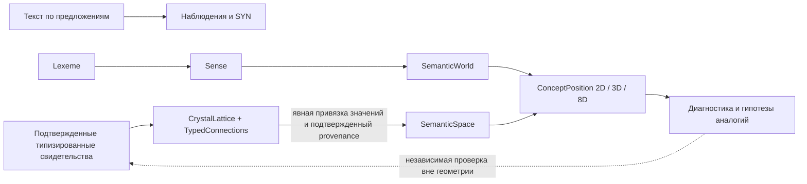

# Экспериментальная контекстно-геометрическая память

## Границы

Слой дополняет CrystalLattice/Resonator, HDC, гипотезы, сон, CrystalReason и
пересмотр убеждений. LLM, RAG, внешних эмбеддингов и зависимостей нет.
Геометрия выключена по умолчанию. Она не участвует в основном tick,
распространении энергии и обратной волне; HDC не заменяется координатами.

## Сначала исправленные основания

`TypedConnections` сохраняет все отношения target→{type→packed}. Методы
`get_type`, `typed_items`, `remove_type` предназначены для типовых запросов.
`dict.items()` остается детерминированной проекцией одного ребра на соседа,
чтобы не умножать энергию от нескольких отношений. Приоритет проекции фиксирован:
CAUSE, EFFECT, IS_A, PART_OF, EXCEPT, ANALOG, остальные, SYN. Повторный SYN
не стирает IS_A. Направленные IS_A/PART_OF не получают ложной обратной связи.
Фреймы, dependency-tree, поиск типовых связей/аналогий и структурные профили читают
полные типы. Старые scalar neighbor views и волновые алгоритмы намеренно используют
проекцию; сравнение дополнительно возвращает `shared_typed_relations`.
Это не полная переработка планирования в multi-relation calculus.

`inject_text` делит документ по `. ! ? ;` и newline до токенизации и обучения
контекстных соседей. Отрицание с неопределенной областью действия сохраняется
наблюдением внутри предложения; следующие предложения продолжают обрабатываться.
Сложные сокращения, вложенные цитаты и внутрипредложенная область действия пока
не разобраны. Текстовое IS_A имеет статус observed, не confirmed.

`generate_text(mode='factual')` требует IS_A/PART_OF/CAUSE и явного
CrystalReason.metadata.status='confirmed', а также не-hypothesis reason.
Иначе возвращает неопределенность. Предположения не формулируются как факты.
Прежняя генерация доступна как `mode='associative'` с явной маркировкой эксперимента.
В этой версии фактический ответ строится только по прямому проверенному ребру:
не реализован новый доказатель цепочек и не заявлена сквозная TMS всех старых путей.

У новых понятий HDC не XOR-ится навсегда с первой эпохой. `identity_hdc` стабилен,
`contextual_hdc[epoch]` — отдельное представление. Legacy `hdc_vector` сохраняется
без переписывания: старые структурные мутации нельзя надежно отделить от первой
эпохи постфактум. Смысловой мир не выводится из эпохи или источника.

## Сущности и свидетельства

`Lexeme` — нормализованная словарная запись и формы; `Sense` — стабильный ID
значения и семантическая роль; `SemanticWorld` — отдельное пространство с допустимыми
ролями; `ConceptPosition` — обученные координаты значения в мире.
Одна лексема может иметь несколько значений; одно значение — несколько миров.
Одинаковое написание не создает ограничения расстояния. `resolve` возвращает
список кандидатов, сохраняя неоднозначность; контекст задается миром и известными
типовыми признаками. Полноценное автоматическое выделение значений из текста
не реализовано. Роли и начальные тестовые миры задаются экспериментом, не являются
универсальной онтологией и не содержат целевых ответов benchmark.

`Evidence` хранит ID, источник, эпоху, диалог, мир, уверенность, знак,
подтвержденность и active. Повтор ID с теми же данными не усиливает свидетельство;
конфликтующий ID отвергается. Отзыв не стирает историю. Противоположные свидетельства
равной уверенности дают неопределенность; более сильное положительное может
вернуть признак. Уверенность — внешняя оценка качества, не доказательство истины.

Сообщества — только предложения connected components из подтвержденных
типовых отношений, по умолчанию с двумя независимыми источниками на отношение.
Они не создают новые миры автоматически. SYN не поддерживается как обучающий сигнал.

## Оптимизация

Общие подтвержденные классы/свойства/роли задают парные положительные ограничения
между субъектами совместимой роли. Аналогия требует минимум двух разных источников.
Явно проверенная INCOMPATIBLE задает дальнее ограничение. Отсутствие отношения
не является отрицательным примером и не создает отталкивания.
Противоречивые близкие/далекие ограничения одной пары исключаются и диагностируются.

Минимизируется взвешенная ошибка расстояний
`sum quality * (||x_a-x_b|| - target_distance)^2`.
Целевые расстояния политики: 0.3 для сходства, 2 для проверенной несовместимости.
Это параметры оптимизатора, а не ручные координаты понятий. Инициализация —
стабильный seed, мир и ID; далее координаты изменяются шагами градиента.
По умолчанию 120 итераций, до 100000 координатных операций, шаг 0.04,
ограничение изменения 0.1 и координат [-10,10]. Перебор пар с общими признаками ограничен
4096 попытками; явные ограничения ограничены числом свидетельств; `constraints_truncated` сообщает усечение. Бюджет не означает
доказанную сходимость. При исчерпании бюджета следующая тренировка может продолжить.

`similarity` проверяет мир и роли, наличие актуальных позиций, затем вычисляет
`exp(-distance) * min(quality) * min(1, min(support_count)/4)`.
Support_count — объем поддержки парных ограничений, не число независимых научных
экспериментов и не калиброванная вероятность. Unknown возвращается как None,
а не ноль и не ложь. После изменения evidence старые позиции считаются устаревшими
до тренировки. Пространства глобально версионируются консервативно: новое
свидетельство может потребовать повторной тренировки других миров.

## Режимы и интеграция

- `off`: исходный типизированный граф, геометрический сигнал не используется.
- `diagnostic`: `geometry_comparison` и поле geometry в `compare_entities`.
- `hypotheses`: явное ранжирование `rank_analogy_hypotheses`; `find_analogies`
  может переставить уже существующих кандидатов. Новые CAUSE/IS_A не создаются.

`configure_geometry`, `bind_semantic_sense` требуют явных миров и значений.
Неоднозначная привязка не разрешается произвольно.
`learn_semantic_evidence` импортирует только подтвержденное типовое ребро с
однозначной привязкой и provenance. Геометрия не повышает статус факта.
Сравнение, ранжирование и просмотр не меняют граф, энергию или статус убеждения.

## Контроль сна

Абстракции хранят DAG компонентов и канонический набор листьев. Повтор состава,
самовключение, обертка над своим подмножеством и цикл отвергаются. Новая
многоуровневая комбинация разрешена как гипотеза. Вводится общий предел 128
учитываемых структурных абстракций, помимо прежних лимитов за цикл.
Fingerprint топологии и provenance делает повторный сон без новых оснований
пустой операцией; изменение одной энергии/веса не считается новым свидетельством.
Изменение источника или типовой структуры допускает новый цикл.
Substring-слияние независимых слов удалено; компоненты существующей абстракции
не удаляются лексическим merge. Старые абстракции без DAG не реконструируются
по догадке из строковых меток. Эффективность произвольных глубоких иерархий не доказана.

## Сохранение и миграция

Бинарные MAGIC, header, записи узлов и ребер full/delta не изменены.
В существующем CRC-защищенном JSON-трейлере появились необязательные поля
`typed_schema=1`, `typed_adjacency`, identity/contextual HDC, semantic schema=1,
конфигурация режимов, DAG и fingerprint сна. Полный и дельта-форматы сохраняют
этот слой. Новый reader принимает graph-only `.cry` и прежние JSON-трейлеры.
В legacy adjacency каждое ребро становится однотипным набором; утраченные ранее
типы/основания неизвестны. Подтвержденность не додумывается.

Проверено чтение нового full-файла reader'ом `1dd4f80`: он получает legacy projection,
игнорируя расширения. Обратная запись старым reader'ом потеряет дополнительные
типы и семантику: downgrade только на копиях, исходные снимки не перезаписывать.
Поврежденные файлы и транзакционная загрузка остаются прежним ограничением.

Пример с реальным изменением координат: `python3 examples/semantic_memory.py`.
Команды тестов и результаты: [SEMANTIC_EXPERIMENTS.md](SEMANTIC_EXPERIMENTS.md).
